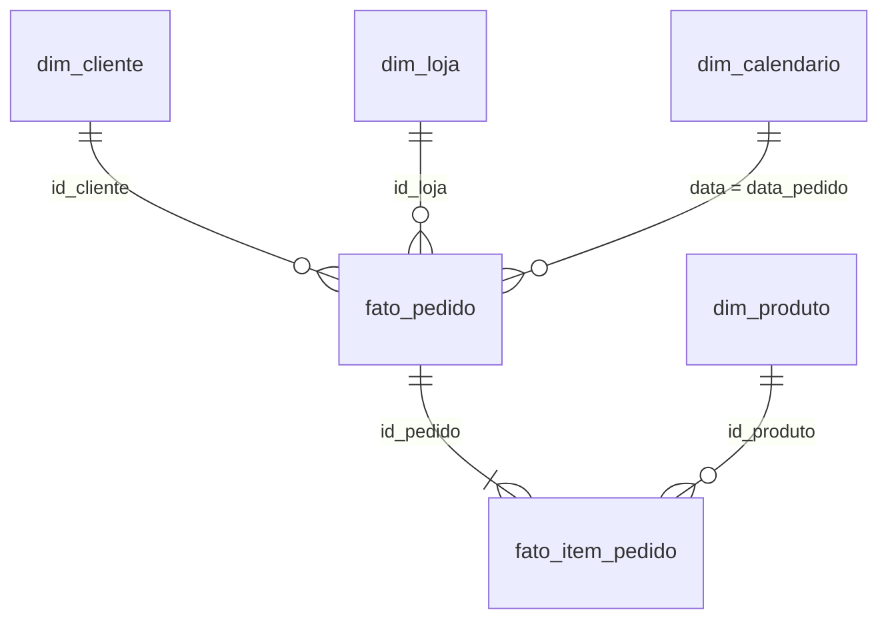

# 2. Modelo de dados e dicionário

## 2.1 Visão geral do fluxo

```
src/gerar_base.py            src/etl.py                        src/validacao.py         src/analise.py         dashboard/app.py
 ┌──────────────┐  CSV   ┌──────────────────────┐  SQLite  ┌────────────────────┐  ┌──────────────────┐  ┌────────────────┐
 │ Gerador      │──────► │ Limpeza, padronização│────────► │ 23 testes de       │─►│ KPIs, RFM+K-means│─►│ Dashboard      │
 │ (seed fixa)  │ raw/   │ transformação e      │ bi.db    │ qualidade (SQL)    │  │ previsão,        │  │ Streamlit      │
 │ 5 tabelas    │        │ integração           │ + CSV    │                    │  │ anomalias        │  │                │
 └──────────────┘        └──────────────────────┘          └────────────────────┘  └──────────────────┘  └────────────────┘
```

## 2.2 Modelo estrela (camada tratada, `data/processed/bi.db`)



Versão em texto (para quem não visualiza Mermaid):

```
 dim_cliente (PK id_cliente) ─┐
 dim_loja    (PK id_loja)    ─┼─< fato_pedido (PK id_pedido) ─< fato_item_pedido (PK id_item) >─ dim_produto (PK id_produto)
 dim_calendario (PK data)    ─┘
```

**Cardinalidades:** um cliente faz 0..N pedidos; uma loja recebe 0..N pedidos; um dia tem 0..N pedidos; um
pedido tem 1..N itens; um produto aparece em 0..N itens.

### Granularidade

| Tabela | Tipo | Grão (uma linha representa…) |
|---|---|---|
| `fato_item_pedido` | Fato | **um produto dentro de um pedido** (grão mais fino, usado para margem e categoria) |
| `fato_pedido` | Fato agregada | um pedido (status, canal, frete e totais somados dos itens) |
| `dim_cliente` | Dimensão | um cliente |
| `dim_produto` | Dimensão | um produto (SKU) |
| `dim_loja` | Dimensão | uma loja (física ou online) |
| `dim_calendario` | Dimensão | um dia |

**Por que duas fatos?** O status, o canal e o frete pertencem ao pedido; categoria, desconto e custo
pertencem ao item. Guardar o frete no item duplicaria valores. Os totais de `fato_pedido` são somas dos itens, e
a validação confere essa reconciliação (teste "Total do pedido ≠ soma dos itens").

## 2.3 Volume e justificativa

| Tabela | Linhas (seed 42) |
|---|---:|
| dim_calendario | 1.096 |
| dim_cliente | 8.000 |
| dim_produto | 120 |
| dim_loja | 11 |
| fato_pedido | 59.437 |
| fato_item_pedido | 105.890 |

**Justificativa do volume:**

- **36 meses** dão 3 ciclos sazonais completos. O Holt-Winters sazonal precisa de pelo menos 2 ciclos de 12
  meses, e a validação de origem móvel precisa de 24 meses de treino e mais meses para testar.
- **≈ 60 mil pedidos** dão mais de 1.000 pedidos por mês. Com isso, cada combinação região × categoria × ano
  tem centenas de pedidos, e as comparações e taxas (como a devolução) ficam estáveis em vez de oscilar por
  acaso.
- **8.000 clientes** (6.834 com compra entregue) dão volume suficiente para o K-means formar grupos
  consistentes.
- O tamanho continua **leve**: cerca de 7 MB de CSV brutos e 17 MB de SQLite, e o pipeline completo roda em
  cerca de 25 segundos num notebook comum. Isso permite demonstrar a reprodutibilidade ao vivo.

## 2.4 Dicionário de dados — camada tratada

### `dim_cliente`
| Campo | Tipo | Descrição | Chave / relacionamento |
|---|---|---|---|
| id_cliente | INTEGER | Identificador do cliente | **PK**; referenciado por `fato_pedido.id_cliente` |
| cidade | TEXT | Cidade (grafia padronizada no ETL) | — |
| uf | TEXT | Sigla do estado, 2 letras maiúsculas | — |
| regiao | TEXT | Região IBGE, derivada da UF | — |
| idade | INTEGER | Idade em 31/12/2025 (nula se nascimento ausente ou inválido) | — |
| faixa_etaria | TEXT | 18-24, 25-34, …, 65+, ou "Não informado" | — |
| data_cadastro | TEXT (AAAA-MM-DD) | Data de cadastro do cliente | — |
| ano_cadastro | INTEGER | Ano do cadastro | — |
| canal_aquisicao | TEXT | Orgânico, Redes Sociais, Google Ads, Indicação, Loja Física | — |

> Nome, e-mail e data de nascimento existem só na base bruta e **são descartados no ETL** (minimização, LGPD).

### `dim_produto`
| Campo | Tipo | Descrição | Chave / relacionamento |
|---|---|---|---|
| id_produto | INTEGER | Identificador do produto | **PK**; referenciado por `fato_item_pedido.id_produto` |
| nome_produto | TEXT | Nome comercial + linha | — |
| categoria | TEXT | Uma de 6 categorias (padronizada no ETL) | — |
| marca | TEXT | Marca fictícia | — |
| linha | TEXT | Essencial ou Premium | — |
| preco_lista | REAL | Preço de tabela (R$) | — |
| custo_unitario | REAL | Custo de aquisição (R$) | — |
| margem_lista_pct | REAL | 1 − custo ÷ preço de lista | — |
| custo_imputado | INTEGER (0/1) | 1 = custo ausente na origem e estimado no ETL | — |

### `dim_loja`
| Campo | Tipo | Descrição | Chave / relacionamento |
|---|---|---|---|
| id_loja | INTEGER | Identificador da loja (11 = e-commerce) | **PK**; referenciado por `fato_pedido.id_loja` |
| nome_loja | TEXT | Nome da loja | — |
| tipo_loja | TEXT | Física ou Online | — |
| canal | TEXT | "Loja física" ou "Online" | — |
| cidade, uf, regiao | TEXT | Localização (o online tem região "Nacional") | — |
| data_abertura | TEXT | Data de inauguração | — |

### `dim_calendario`
| Campo | Tipo | Descrição | Chave / relacionamento |
|---|---|---|---|
| data | TEXT (AAAA-MM-DD) | Dia | **PK**; referenciado por `fato_pedido.data_pedido` |
| ano, mes, trimestre | INTEGER | Partes da data | — |
| nome_mes | TEXT | Jan…Dez | — |
| ano_mes | TEXT | AAAA-MM (eixo dos gráficos mensais) | — |
| dia_semana | INTEGER | 1 = segunda … 7 = domingo | — |
| nome_dia_semana | TEXT | Segunda…Domingo | — |
| fim_de_semana | INTEGER (0/1) | 1 = sábado ou domingo | — |
| evento_comercial | TEXT | Black Friday (sexta a Cyber Monday), Natal (1–24/dez), Dia das Mães, Dia dos Pais, Nenhum | — |

### `fato_pedido`
| Campo | Tipo | Descrição | Chave / relacionamento |
|---|---|---|---|
| id_pedido | INTEGER | Identificador do pedido | **PK**; referenciado por `fato_item_pedido` |
| id_cliente | INTEGER | Cliente que comprou | **FK** → `dim_cliente` |
| id_loja | INTEGER | Loja ou e-commerce da venda | **FK** → `dim_loja` |
| data_pedido | TEXT | Data da compra | **FK** → `dim_calendario.data` |
| canal | TEXT | Online ou Loja física (herdado da loja) | — |
| forma_pagamento | TEXT | Pix, Cartão de Crédito, Cartão de Débito, Boleto, Dinheiro | — |
| status | TEXT | Entregue, Cancelado ou Devolvido | — |
| valor_frete | REAL | Frete cobrado (R$); 0 em loja física ou acima de R$ 299 | — |
| qtd_itens | INTEGER | Soma das quantidades dos itens | — |
| receita_bruta, valor_desconto, receita_liquida, custo_total, margem_bruta | REAL | Somas dos itens do pedido (R$) | — |

### `fato_item_pedido`
| Campo | Tipo | Descrição | Chave / relacionamento |
|---|---|---|---|
| id_item | INTEGER | Identificador da linha do pedido | **PK** |
| id_pedido | INTEGER | Pedido ao qual o item pertence | **FK** → `fato_pedido` |
| id_produto | INTEGER | Produto vendido | **FK** → `dim_produto` |
| quantidade | INTEGER | Unidades (1 a 20) | — |
| preco_unitario | REAL | Preço praticado antes do desconto (R$) | — |
| desconto_pct | REAL | Desconto em fração (0,15 = 15%) | — |
| receita_bruta | REAL | quantidade × preco_unitario | — |
| valor_desconto | REAL | receita_bruta × desconto_pct | — |
| receita_liquida | REAL | receita_bruta − valor_desconto | — |
| custo_total | REAL | quantidade × custo_unitario do produto | — |
| margem_bruta | REAL | receita_liquida − custo_total | — |

### Visão e tabelas de análise
- `vw_vendas`: visão desnormalizada (item + pedido + cliente + produto + loja + calendário), usada pelo
  dashboard e pelo notebook.
- `an_rfm_cliente`, `an_segmentos`, `an_escolha_k`: resultados da segmentação.
- `an_previsao_receita`, `an_metricas_previsao`, `an_backtest_previsao`: resultados da previsão.
- `an_receita_diaria`: receita diária, mediana móvel, z-score e marcação de anomalias.

## 2.5 Base bruta (`data/raw`, saída do gerador)

| Arquivo | Campos | Problemas inseridos de propósito |
|---|---|---|
| clientes.csv | id_cliente, nome, email, data_nascimento, cidade, uf, data_cadastro, canal_aquisicao | UF e cidade com caixa, espaços e acentos variados; e-mail e nascimento nulos; nascimento 1900-01-01; linhas duplicadas |
| produtos.csv | id_produto, nome_produto, categoria, marca, linha, preco_lista, custo_unitario | Categoria com grafias variadas; preço no formato "1.299,90"; custo nulo |
| lojas.csv | id_loja, nome_loja, tipo_loja, cidade, uf, regiao, data_abertura | — |
| pedidos.csv | id_pedido, id_cliente, id_loja, data_pedido, forma_pagamento, status, valor_frete | Datas DD/MM/AAAA misturadas com AAAA-MM-DD; status com caixa variada; frete negativo; cliente inexistente (FK órfã); duplicatas |
| itens_pedido.csv | id_item, id_pedido, id_produto, quantidade, preco_unitario, desconto_pct | Quantidade 0, negativa ou 999; preço nulo; desconto como texto ("15%" ou "15"); duplicatas |

A quantidade exata de cada problema fica em `data/raw/_problemas_inseridos.json`. O tratamento aplicado a cada
um está em `reports/relatorio_qualidade.md`.
